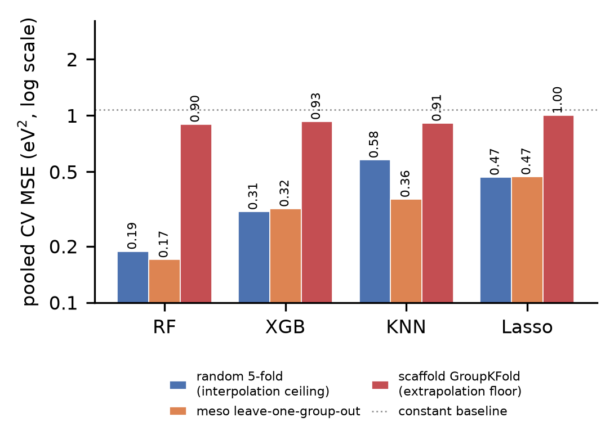

# B 轴（meso 取代基）的留一组外推交叉验证

> 目的：正式 B 轴实验只留出 `{B5, B11, B15}` 三个组，而这三组在 16 个组里偏易；同时正式五折的 fold0 把 B0（无取代基母体）放在验证侧，又把 CV 拉高。两个数字各自只测了这条轴的局部。本报告把 15 个取代基组重排成 5 折，让**每个组都当一次验证集**，并单独评估 B0，得到这条轴的无偏难度估计。

## 1. 协议

- 数据：1,734 条有效记录；特征：Mordred 1,613 列，折内按 `fit_preprocessing` 筛到约 520 列（管线的同一条代码路径）
- 折划分：`np.random.RandomState(42)` 打乱 15 个取代基组后切成 5 折，每折留 3 整组；其余 12 组 + B0 作训练。组不被拆散，因此验证组在训练中完全没出现
- 模型与超参：直接取 `experiments\20261021_B-M` 里 Optuna 调好的最优参数（不重新调参，避免“为某条轴调优”的偏袒）
- 主指标：**池化 MSE**（把五折验证预测拼起来算一次），与 `指纹-*折内消融.md` 口径一致；`R² = 1 − MSE / Var(y)`（1.0725）
- 同时给逐折 MSE 与「只用训练折均值」的常数基线，便于判断模型是否真的学到东西

| 折 | 留出的 B 组 | n_valid |
|---|---|---|
| fold0 | B[8, 9, 10] | 323 |
| fold1 | B[3, 11, 12] | 318 |
| fold2 | B[1, 2, 13] | 315 |
| fold3 | B[4, 14, 15] | 327 |
| fold4 | B[5, 6, 7] | 325 |

## 2. 留一组外推的结果

| 模型 | 池化 MSE | R² | 逐折 MSE | 逐折常数基线 |
|---|---|---|---|---|
| RandomForest（树集成） | **0.1696** | +0.8419 | 0.109 / 0.141 / 0.178 / 0.218 / 0.202 | 1.120 / 1.179 / 0.995 / 1.052 / 1.011 |
| XGBoost（梯度提升树） | **0.3177** | +0.7038 | 0.296 / 0.338 / 0.286 / 0.315 / 0.353 | 1.120 / 1.179 / 0.995 / 1.052 / 1.011 |
| KNeighbors（实例） | **0.3569** | +0.6673 | 0.227 / 0.351 / 0.452 / 0.532 / 0.223 | 1.120 / 1.179 / 0.995 / 1.052 / 1.011 |
| Lasso（线性） | **0.4712** | +0.5607 | 0.420 / 0.604 / 0.451 / 0.484 / 0.398 | 1.120 / 1.179 / 0.995 / 1.052 / 1.011 |

## 3. 与随机／骨架轴在同一协议下的对照

> 同一特征矩阵、同一预处理、**同一组超参**（取自 B-M），只换划分方式。`random` 是逐行 5 折（内插上限），`meso` 是本报告的留一组（换取代基），`scaffold` 是按 A_number 分组的 5 折（外推下限）。

| 模型 | 随机 KFold | meso 留一组 | 骨架 GroupKFold |
|---|---|---|---|
| RandomForest（树集成） | 0.1881 | **0.1696** | 0.8994 |
| XGBoost（梯度提升树） | 0.3063 | **0.3177** | 0.9288 |
| KNeighbors（实例） | 0.5790 | **0.3569** | 0.9102 |
| Lasso（线性） | 0.4682 | **0.4712** | 1.0011 |

| 模型 | 随机 R² | meso R² | 骨架 R² |
|---|---|---|---|
| RandomForest（树集成） | +0.8247 | +0.8419 | +0.1614 |
| XGBoost（梯度提升树） | +0.7144 | +0.7038 | +0.1340 |
| KNeighbors（实例） | +0.4601 | +0.6673 | +0.1513 |
| Lasso（线性） | +0.5634 | +0.5607 | +0.0666 |

一个可以立刻读出来的事实：**随机与 meso 的柱子几乎等高，骨架的柱子在所有模型上都跳到 0.90 以上**（甚至越过常数基线 1.07）。换句话说，只要保留“其它取代基”的信息，模型就能把这个取代基的效应迁移过去；一旦换成没见过的骨架，连“预测折内均值”都不如。

## 4. B0：这条轴上唯一真正的外推

B0 是 meso 位为 H 的母体（无取代基），只有 A13/A14 用它。下表把 15 个取代基组全部用作训练、对 B0 的 126 条做预测——这正是“预测一个训练中从未出现过的取代基状态”。

| 模型 | B0 MSE | B0 R² | 平均偏差（预测−真值） | 剔除未见骨架后 MSE | 与常数基线比较 |
|---|---|---|---|---|---|
| RandomForest（树集成） | 9.7130 | -7.9601 | +2.78 eV | 10.2869（n=106） | **劣于常数基线**（常数 1.0945） |
| XGBoost（梯度提升树） | 2.1998 | -1.0293 | +1.07 eV | 2.2072（n=106） | **劣于常数基线**（常数 1.0945） |
| KNeighbors（实例） | 0.8232 | +0.2406 | +0.31 eV | 0.7862（n=106） | 优于常数基线（常数 1.0945） |
| Lasso（线性） | 0.9432 | +0.1299 | +0.47 eV | 0.9938（n=106） | 优于常数基线（常数 1.0945） |

### 4.1 树模型在 B0 上系统性高估

RandomForest 对 B0 的预测均值是 **8.97 eV**，而真值是 **6.19 ± 1.05 eV**——几乎每条都被抬高 2.8 eV（A1 真值 6.20 → 预测 9.39；A7 真值 6.64 → 预测 10.17）。这不是少数离群点造成的：剔除训练中完全没出现过的 A13/A14 之后，MSE 仍是 **10.29**（n=106），偏差基本不变。

机制：树的预测只能落在训练标签的局部均值上，而“没有 meso 取代基”这个取值在训练集里从未出现，描述符落到了稀疏区，树叶只能给出该区域里高 gap 样本的均值。线性模型（Lasso，偏差 +0.47 eV）与实例模型（KNeighbors，+0.31 eV）会平滑地回落到总体均值，所以不崩——XGBoost 介于两者之间（+1.07 eV），这与骨架轴上“树模型崩、线性模型还能撑”的模式一致。

## 5. 结论

1. **meso 轴基本就是插值难度，不是“中间档”。** 同一协议、同一超参下，RandomForest 的留一组 MSE（0.1696）甚至低于随机 KFold（0.1881），XGBoost（0.3177 vs 0.3063）与 Lasso（0.4712 vs 0.4682）基本持平。换一个 meso 取代基、同时保留其它取代基的信息，模型是能迁移的。
2. **骨架轴是唯一真正的外推失败。** 三个模型族在骨架 GroupKFold 上都落到 0.90–1.00（R² 仅 +0.07–+0.16），比 meso 轴差 2–5 倍；且每次骨架折里都有一个折（含 A4，gap 11.16 eV）把 MSE 顶到 2.7–2.9。
3. **meso 轴内部的外推点是 B0，而且只有树模型会崩。** RandomForest 在 B0 上 MSE 9.71（劣于常数基线 1.09），XGBoost 2.20（也劣于基线），而 Lasso 0.94、KNeighbors 0.82 仍优于基线。因此“meso 轴友好”这句话必须加限定：**保留取代基时友好；去掉取代基回母体时，树模型不可用。**
4. **正式实验的 Test R² 0.87–0.96 是乐观值。** 单次留出的 B5/B11/B15 偏易；留一组估计给出的 R² 是 RandomForest +0.84、XGBoost +0.70、KNeighbors +0.67、Lasso +0.56。两者都在“可用”区间，但差 10 个百分点以上，稿件应报后者或同时报两者。

## 6. 口径与限制

- **超参混淆**：所有模型都用 B-M（meso 五折）调出的参数，理论上对 meso 轴略有偏袒；但 RandomForest/XGBoost 在同一组参数下随机 KFold 反而更差，说明偏袒不是主导因素。若要彻底消除，需要每条轴各自调参——那会引入新的“为轴调参”问题。
- **B0 混入了骨架外推**：B0 的 126 条里，A13/A14 的骨架在训练集中完全没出现（它们只用 B0）。剔除这两族后 RandomForest 的 B0 MSE 仍为 10.29，结论不变，但严格说 B0 是“无取代基 + 未见骨架”的复合外推。
- **单 seed**：折划分用 seed 42 一次。组只有 15 个，折间 MSE 的标准差已在表里给出（见逐折列）。
- 本报告只用 Mordred 特征；混合特征（9,972 列）在同协议下的留一组结果尚未跑。

## 7. 复现

- 留一组：`.dsh_tmp\baxis_lobo_cv.py` → `.dsh_tmp\baxis_lobo_cv.json`
- 三轴对照：`.dsh_tmp\split_reference_cv.py` → `.dsh_tmp\split_reference_cv.json`
- 本报告：`.dsh_tmp\render_b_lobo_report.py`（只从上面两个 JSON 取数）
